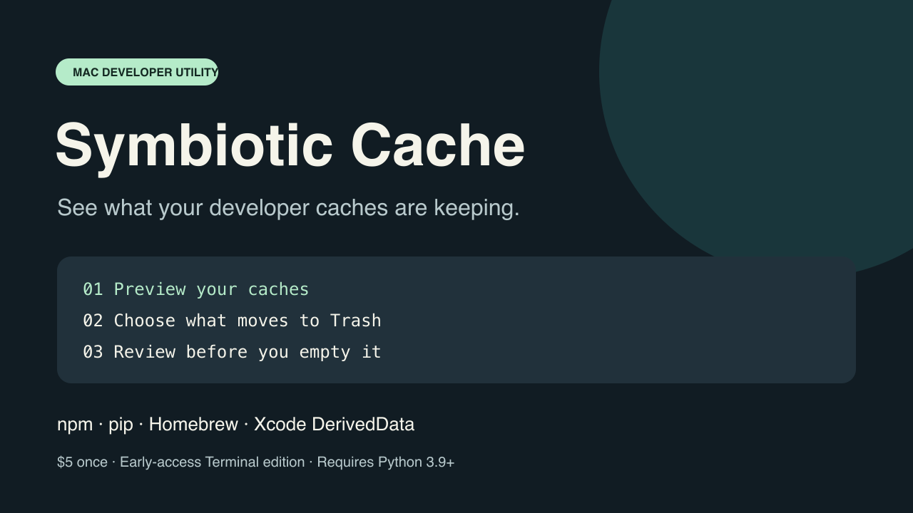

# Symbiotic Cache



A small Terminal utility for Mac developers. See the size of common build and download caches, preview your selections, and move selected folders to Trash after explicit confirmation.

**Early access is being prepared. Planned price: $5 once. Checkout is not open yet.**

## What it does

- Scans npm, pip, Homebrew, and Xcode DerivedData.
- Shows selected cache paths before changing anything.
- Requires you to type `MOVE` before moving caches to Trash.
- Leaves Trash for you to review and empty in Finder.
- Runs locally, without sudo, telemetry, background services, or an activation server.

The command remains `macbroom` from the original prototype:

```sh
python3 macbroom scan
python3 macbroom clean npm pip
python3 macbroom clean npm pip --apply
```

## Who it is for

Developers comfortable with Terminal, running macOS with Python 3.9 or later already installed. Python is not bundled. This release has no graphical interface.

Close affected tools and stop builds/installations before moving caches. Next use may require rebuilding or downloading cache data. Moving files to Trash does not free storage until Trash is emptied. Reported sizes are logical estimates, not guaranteed reclaimed space.

## Current status

Version 0.2.0-beta.2 has passed 17 automated fixture tests on macOS 26.6.2, Apple silicon, Python 3.13.2. The actual release archive has also passed an isolated move-and-restore test. Independent Intel and older-macOS trials remain outstanding. No paid checkout is available yet.

This repository contains product information and feedback templates. The commercial download and its readable source will be supplied through the storefront when it opens.

## Interested in testing?

[Request a beta trial](https://github.com/SymbioticDataConsultancy/symbiotic-cache-info/issues/new?template=beta-request.md) or [report a problem](https://github.com/SymbioticDataConsultancy/symbiotic-cache-info/issues/new?template=bug-report.md).

Issues are public. Please redact personal paths and do not post passwords, cache contents, purchase receipts, or private package URLs.
